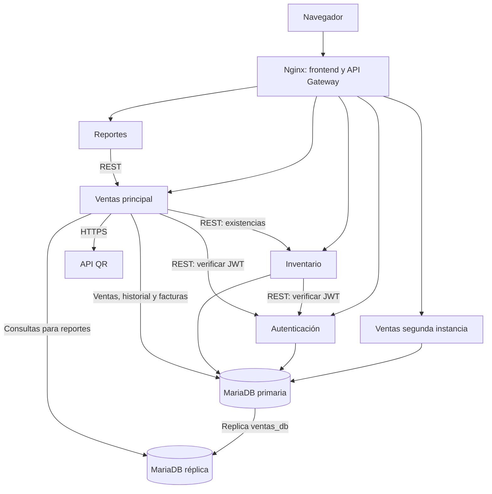

# Arquitectura actual de FerreSync

Cada servicio conserva su responsabilidad y sus credenciales. Autenticación usa auth_db, Inventario inventario_db y Ventas ventas_db. Reportes pide los datos a Ventas por REST; reportes_db permanece reservada. La cuenta de reportes en la réplica solo permite lectura y supervisión de la replicación.

Nginx publica la interfaz y las rutas API en el puerto local 8080. Los cuatro servicios PHP y MariaDB se comunican por redes Docker. Adminer es opcional y publica únicamente localhost:8085 para consultar tablas.

La primaria tiene server_id=1 y la réplica server_id=2. Solo ventas_db se replica. Las configuraciones, el respaldo inicial y las pruebas se explican en [replicacion.md](replicacion.md).

Están implementados JWT RS256, roles, usuarios, inventario, ventas con descuento de stock, factura PDF, QR, historial y reportes con gráficas y PDF. Pagos de prueba y despliegue temporal en VPS Hostinger siguen pendientes. El cliente del clima está preparado, pendiente de clave y consulta real. Nginx balancea Ventas entre dos instancias; Reportes llama a ese grupo a través del gateway. No hay failover automático.
