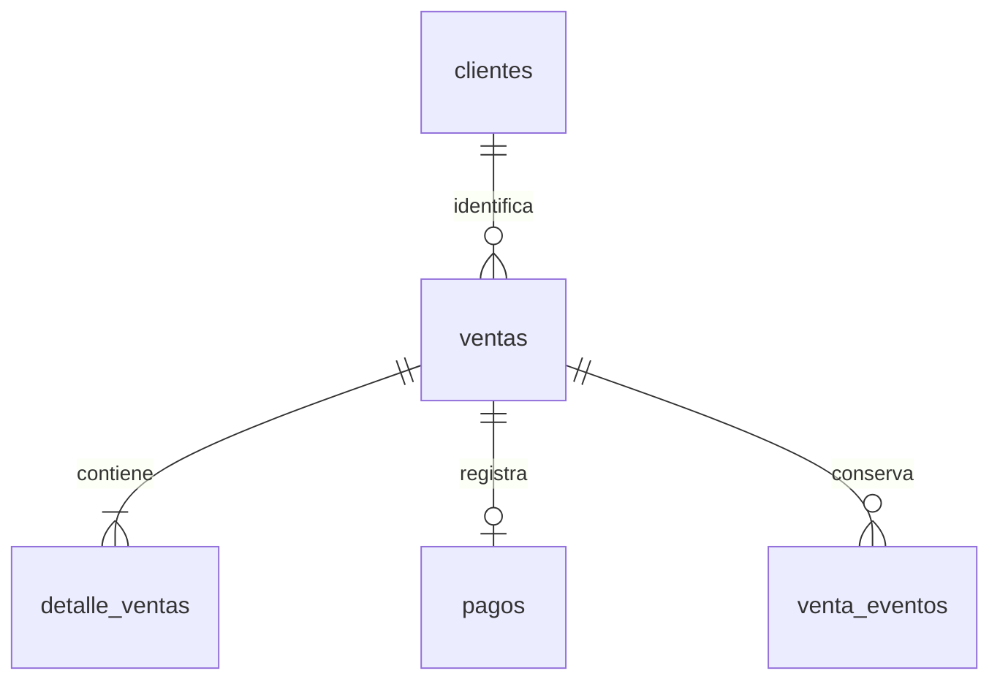

# Relaciones de la base de datos

Cada microservicio es dueño de sus datos. No se crean claves foráneas entre bases de servicios distintos; los identificadores de vendedor y producto se intercambian por REST.

## Ventas

clientes guarda un registro por NIT. Una venta CF deja cliente_id vacío. ventas guarda vendedor, referencia única, total, IVA incluido, moneda, método de pago, estado y datos de anulación. Los datos del comprador también se guardan en ventas como copia del comprobante: actualizar el cliente no cambia facturas anteriores.

detalle_ventas pertenece a ventas y conserva código, nombre, precio y categoría del producto en ese momento. producto_id no tiene una FK hacia Inventario. pagos pertenece a ventas mediante una FK y, en este bloque, registra el cobro en efectivo. No se guardan números de tarjeta ni CVV. PayPal Sandbox añade estados pendiente y reembolso_pendiente, identificadores únicos de orden/captura/reembolso e importe USD con tasa de demostración. Solo se aprueba el pago después de verificar la captura con el proveedor; la validación externa con cuenta propia está pendiente.

venta_eventos pertenece a la venta y registra corrección del comprador, solicitud de anulación y anulación final. La venta no se elimina durante una anulación. Las FK con ON DELETE CASCADE de pagos/eventos sirven para limpiar fixtures de pruebas; no existe una ruta de negocio que borre ventas.

## Inventario

categorias tiene muchos productos. Cada producto tiene muchos movimientos_stock. descuentos_venta conserva una respuesta por referencia de compra. devoluciones_venta apunta a esa referencia y garantiza una sola devolución. Tanto el descuento como la reposición se guardan en una transacción local junto con sus movimientos.

## Autenticación

usuarios guarda nombre, email único, hash bcrypt, rol y estado. usuario_eventos relaciona la cuenta afectada y el administrador que cambió su acceso.

## Reportes y réplica

Reportes solicita estadísticas por REST a Ventas. Ventas consulta su propia ventas_db en la réplica usando una cuenta de lectura. Solo ventas_db se replica; reportes_db está reservada y no almacena una copia innecesaria de las ventas.

Las migraciones se aplican en orden con scripts/migrate.ps1 y generan respaldo antes de tocar el esquema. db-master/demo.sql contiene productos opcionales de demostración y no se aplica automáticamente sobre los datos del usuario.

La venta pendiente_pago conserva los precios y aparta stock, pero no emite factura ni suma en reportes. La migración 010 amplía estados y guarda los identificadores del proveedor sin almacenar tarjetas. Si el administrador anula un cobro Sandbox, primero se confirma el reembolso y después vuelve el stock.

## Turnos de efectivo

`cajas` registra fondo, propietario, fechas y cierre definitivo. Un índice único de columna generada permite un solo turno abierto por usuario. `caja_movimientos` relaciona turno y venta mediante claves foráneas; su índice único evita duplicar ingreso/devolución de una factura. `ventas.caja_devolucion_id` referencia el turno del administrador que entregará la devolución y permite impedir el cierre durante una anulación pendiente. Las ventas anteriores conservan sus datos sin crear movimientos retroactivos. Ver [cuadre](cuadre-caja.md).
